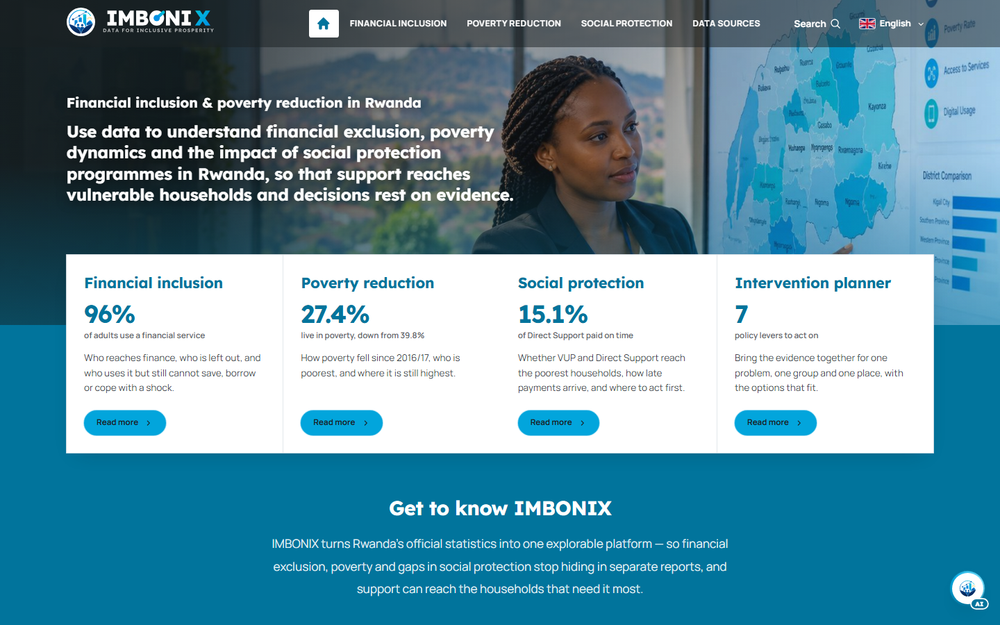
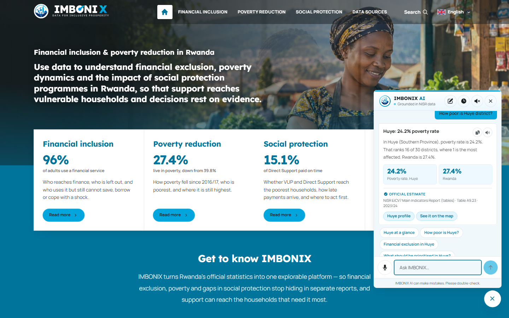
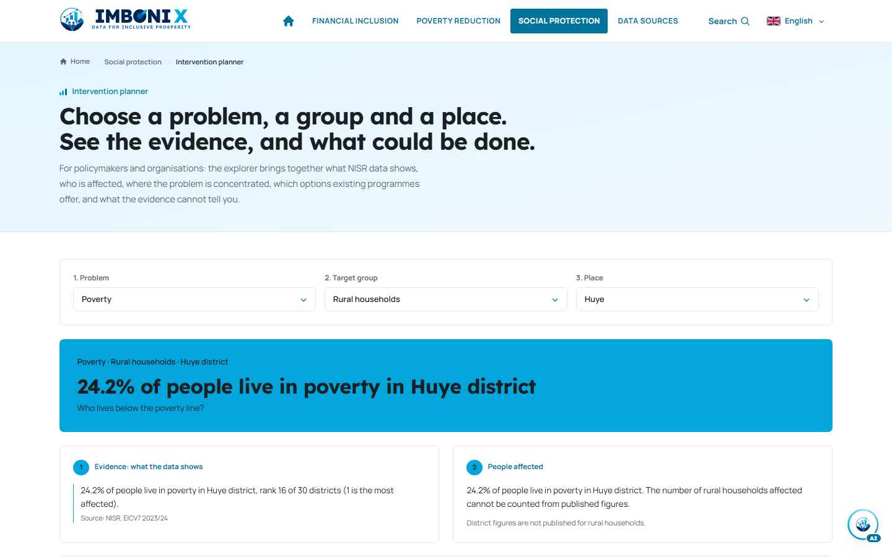
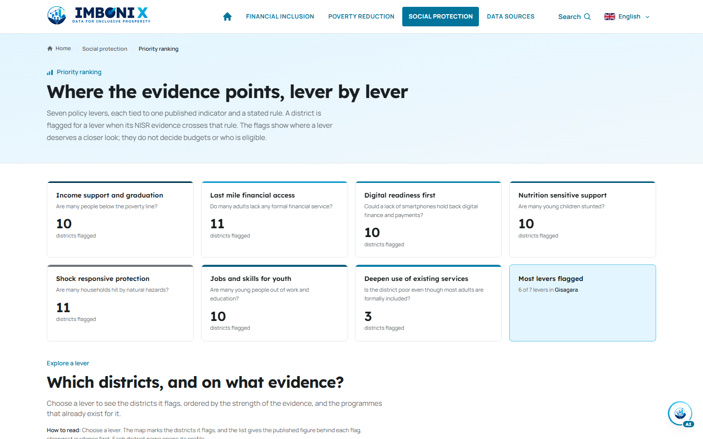
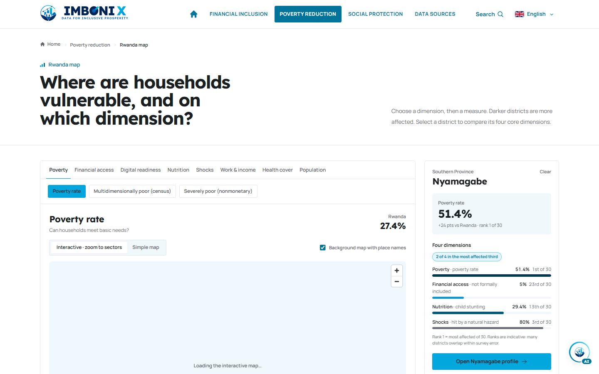
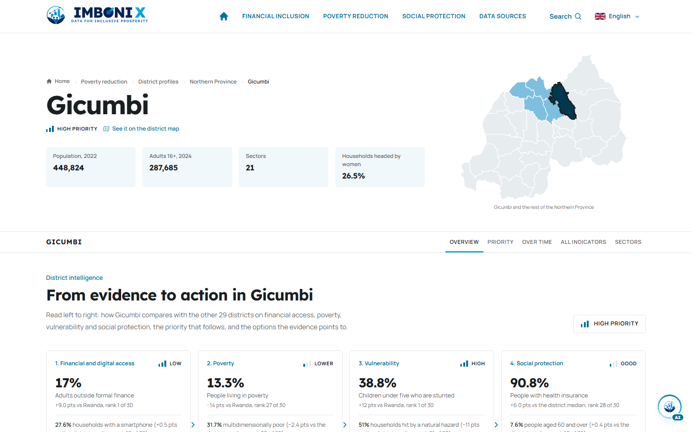
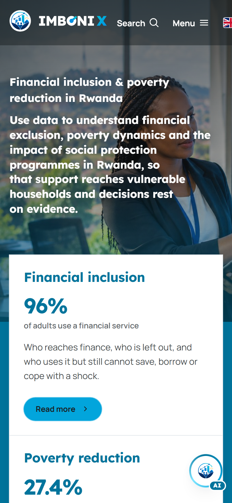
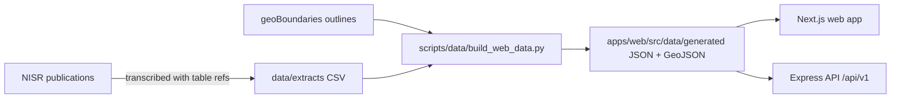

<p align="center">
  
</p>

<h1 align="center">IMBONIX</h1>

<p align="center">
  <strong>Turning Rwanda's data into clear, actionable intelligence for financial inclusion, poverty reduction and social protection.</strong><br>
  NISR 2026 Big Data Hackathon &middot; Track 2: Financial Inclusion &amp; Poverty Reduction
</p>

<p align="center">
  <a href="https://github.com/dieumerci-niyonkuru/imbonix-nisr-hackathon-2026/actions/workflows/ci.yml"></a>
</p>

---

## The problem

96% of Rwandan adults use a financial service (FinScope 2024), yet only ~10% are financially healthy. Poverty, poor nutrition, natural hazards and late social-protection payments cluster in different districts. A place that looks fine on one measure can be among the worst on another. Planners need to see where these vulnerabilities overlap — and where to act first.

## What IMBONIX does

IMBONIX puts NISR's published statistics side by side for all **30 districts** and **416 sectors**, so anyone can see:

- **Where poverty is highest** and how it has changed
- **Who is financially excluded** and who is included but not resilient
- **Where social protection falls short** — late payments, low coverage, unmet targets
- **Which policy levers** the evidence points to, district by district
- **Downloadable data** — every chart offers a CSV export with the source named

Every number carries its source, table, year and a trust label. Uncertainty is shown wherever NISR publishes it. IMBONIX is an independent team project — **not an official NISR product**.

## For judges

| # | Document | What it covers | Time |
|---|----------|---------------|------|
| 1 | **[Solution overview](docs/submission/solution-overview.md)** | Problem, solution, data, tech, design, impact — with a criterion-by-criterion mapping | ~5 min |
| 2 | **[Criteria evidence](docs/submission/criteria-evidence.md)** | Each evaluation criterion answered point by point | ~5 min |
| 3 | **[IMBONIX AI](docs/ai-assistant.md)** | How the grounded, multilingual, voice-capable assistant works | ~4 min |
| 4 | **[AI-assistance disclosure](docs/submission/ai-disclosure.md)** | How AI tools were used; the team's responsibility for every figure | ~1 min |

**Five criteria at a glance:**

| Criterion | Where to see it |
|-----------|----------------|
| Problem understanding & relevance | Homepage overview chart and gap chart; ask IMBONIX AI |
| Data use & methodology | `/data` sources page; every chart names its NISR source |
| Tech innovation | On-device AI, risk model, policy scenarios, intervention planner |
| Usability & design | Homepage charts with download, district map, chart library |
| Tangible impact | Priority districts, intervention planner, downloadable CSVs |



## Key features

<table>
  <tr>
    <td width="50%"><br><sub><b>IMBONIX AI</b> — ask in English, French or Kinyarwanda, by text or voice. Answers only from NISR figures.</sub></td>
    <td width="50%"><br><sub><b>Intervention planner</b> — pick a problem, a group and a place: see the evidence and what could help.</sub></td>
  </tr>
  <tr>
    <td><br><sub><b>Priority ranking</b> — where to act first, flagged by seven transparent policy-lever rules.</sub></td>
    <td><br><sub><b>District map</b> — 28 measures mapped for all 30 districts, colour-blind-validated.</sub></td>
  </tr>
  <tr>
    <td><br><sub><b>District profile</b> — every published indicator with year-by-year trends.</sub></td>
    <td align="center"><br><sub><b>Mobile</b> — the whole platform works on a phone.</sub></td>
  </tr>
</table>

## IMBONIX AI

A floating assistant on every page that answers questions without reading a whole dashboard:

- **Grounded** — answers only from the NISR figures bundled with the site; it cannot invent a number
- **On-device** — no external model, no API key, no network call; works offline, free and private
- **Multilingual** — English, French and Kinyarwanda, by text or voice (Web Speech API)
- **Deterministic** — the same question always gives the same sourced answer

See [docs/ai-assistant.md](docs/ai-assistant.md) for the architecture.

## Site map

| Area | Pages | What it covers |
|------|-------|---------------|
| **Financial exclusion** | Overview, Access & use, Risk model | Who reaches finance, who is left out, financial health vs access |
| **Poverty dynamics** | Overview, Trends (1978-2024), District map, 30 district profiles, Overlapping needs | Where poverty is deepest, how it changed, where vulnerabilities overlap |
| **Social protection** | Overview, VUP payments, Priority districts, Policy scenarios, Intervention planner | Who programmes reach, payment timeliness, where to act first |
| **Data & About** | Sources & methods, Key figures, Data catalogue, Chart library, About | Every source, every chart, the method and the limits |

## Getting started

**Prerequisites:** Node.js 22.9+ and npm 10. Python 3.12+ only to rebuild data. Docker optional.

```bash
git clone git@github.com:dieumerci-niyonkuru/imbonix-nisr-hackathon-2026.git
cd imbonix-nisr-hackathon-2026

# Web app on http://localhost:3000
cd apps/web
npm ci
npm run dev

# API on http://localhost:4000 (second terminal)
cd apps/api
npm ci
npm run dev
```

The website does not depend on the API — both read the same generated data. No secrets or API keys are needed.

### Docker

```bash
docker compose up --build
# Web: http://localhost:3000  API: http://localhost:4000
```

## Tech stack

| Layer | Tools |
|-------|-------|
| Web app | Next.js 15 (App Router), React 19, TypeScript, Tailwind CSS, Radix UI primitives |
| AI assistant | On-device engine over NISR data (no external model); Web Speech API for voice |
| Charts & maps | Recharts, custom SVG, MapLibre GL with OpenFreeMap tiles, geoBoundaries outlines |
| API | Node.js 22, Express 5, zod, helmet, rate limiting |
| Data pipeline | Python 3.12+ (openpyxl, xlrd for extraction) |
| Quality | Vitest, supertest, ESLint, Prettier, gitleaks, npm audit |
| Delivery | Docker multi-stage, docker compose, GitHub Actions CI |

## Architecture



No database — the site serves a small, versioned set of published aggregates. See [docs/architecture.md](docs/architecture.md).

## Project structure

```
apps/
  web/              Next.js app: pages, components, lib (data, scales, rules), generated data
  api/              Express API: routes, middleware, data store, tests
data/
  extracts/         Published NISR tables transcribed to CSV
  dictionaries/     Microdata catalog index and variable dictionaries
  schemas/          JSON schema for indicators
scripts/
  data/             Extraction and build scripts with tests
  brand/            Logo and colour palette generation
docs/
  submission/       Solution overview, criteria evidence, AI disclosure
  data/             Data sources plan, inventory, microdata access
  research/         Hackathon brief, Track 2 research dossier
  screenshots/      App screenshots for README and submission
```

## How the data is handled

- **Only published figures** — transcribed from NISR and partner reports with table references
- **Every value is labelled** — official estimate, calculation, model estimate, projection or scenario
- **No composite score** — dimensions shown side by side; ranks are indicative
- **No causal claims** — surveys are cross-sections; the site describes associations, not causes
- **No microdata in git** — stays in ignored folders under NISR's terms of use
- **Reproducible** — `scripts/data/build_web_data.py` rebuilds everything; CI checks it matches exactly
- **Downloadable** — homepage charts include CSV download with source attribution

## Tests

| Where | Command | Coverage |
|-------|---------|----------|
| `apps/web` | `npm test` | Data integrity, formatting, colour scales, province weighting, priority rules, scenarios |
| `apps/web` | `npm run lint && npm run typecheck && npm run build` | ESLint, TypeScript, production build |
| `apps/api` | `npm test` | Endpoints, validation, rate limits, CORS, security headers |
| Root | `python -m unittest discover -s scripts/data/tests -v` | Build helpers, extract integrity |

CI runs all checks on every push, plus npm audit and gitleaks secret scanning.

## Adding features in the future

The project is structured so new features can be added without starting from scratch:

- **New data themes**: add a CSV to `data/extracts/`, a TypeScript file in `apps/web/src/lib/`, and a page in `apps/web/src/app/` — the same pattern every existing theme follows
- **New chart types**: add a component in `apps/web/src/components/charts/recharts/` using the shared `chart-theme.tsx` and `palette.ts`
- **New districts or indicators**: update the extracts, run `scripts/data/build_web_data.py`, and the site picks them up automatically
- **New AI knowledge**: extend the data arrays in `apps/web/src/lib/assistant.ts` — no model retraining needed
- **New API endpoints**: add a route file in `apps/api/src/routes/` following the existing pattern with zod validation

## API

```bash
curl http://localhost:4000/api/v1/districts/nyamagabe?indicators=eicv7_poverty_rate
```

Returns district data with indicator values, standard errors and confidence intervals. Full documentation: [docs/api.md](docs/api.md).

## Deployment

Recommended: deploy on **Vercel** — the JSON API ships with the site at `/api/v1`, so one project serves everything. Docker and Railway are also supported. See [docs/deployment.md](docs/deployment.md).

## Security

No secrets required or stored. CSP headers on the web app, parameter validation and rate limiting on the API. See [SECURITY.md](SECURITY.md) and [docs/security.md](docs/security.md).

## Team

IMBONIX was built by two Year 3 students at **RP Tumba College** (Advanced Diploma in Information Technology, 2026–2027).

<table>
  <tr>
    <td align="center" width="50%"><br><b>NIYONKURU Dieu Merci</b><br>24RP03511<br>Software development, UI/UX design, IMBONIX AI, deployment<br><a href="https://github.com/dieumerci-niyonkuru">@dieumerci-niyonkuru</a></td>
    <td align="center" width="50%"><br><b>UMURERWA Divine</b><br>24RP01840<br>Data analysis, data collection and sourcing of NISR datasets</td>
  </tr>
</table>

## Data sources

- **Statistics:** NISR and partners (MINAGRI/WFP for CFSVA 2024; AFR for FinScope), cited on each page
- **Microdata catalog:** [microdata.statistics.gov.rw](https://microdata.statistics.gov.rw/index.php/catalog)
- **Boundaries:** [geoBoundaries](https://www.geoboundaries.org/) (CC BY 4.0), from NISR open geodata
- **Map tiles:** [OpenFreeMap](https://openfreemap.org/), OpenMapTiles, OpenStreetMap contributors

## AI assistance

The team downloaded every dataset, designed the solution, chose all chart types, and reviewed every line of code. AI (Claude Code) helped with coding, suggesting chart types, generating two homepage background images, and drafting documentation. No figure was generated by AI. IMBONIX AI is the team's own 947-line TypeScript engine, not an external LLM. See [docs/submission/ai-disclosure.md](docs/submission/ai-disclosure.md).

## Declaration

This submission is the team's own work. All sources are acknowledged: every figure names its NISR publication, table and year on screen. The processed figures are committed in `apps/web/src/data/generated/`, rebuilt from public NISR files by `scripts/data/`. Raw microdata is accessed from the NISR microdata catalog and never redistributed. AI assistance was used as noted above.

## License

All rights reserved by the team. The competition's IP terms and NISR's data terms of use apply. A licence will be chosen after the hackathon.
