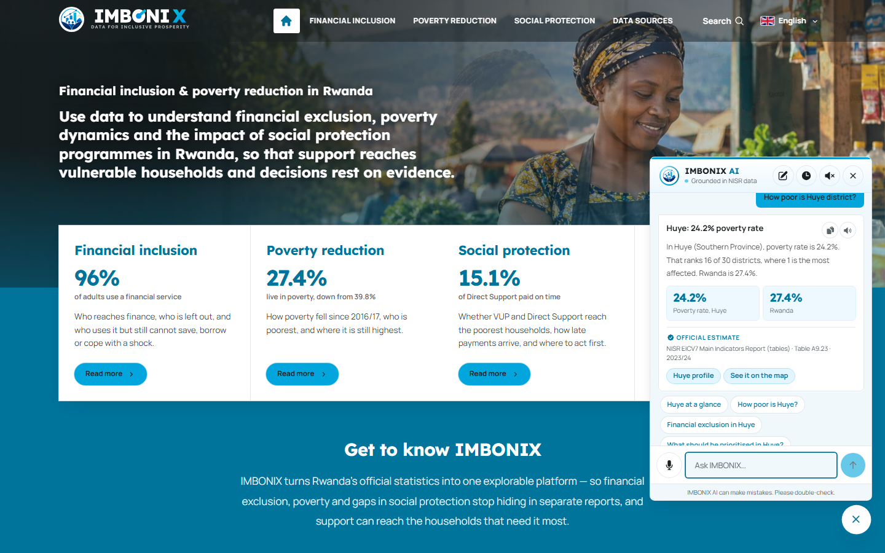

# IMBONIX AI — the grounded, on-device assistant

> **Submission package:** [Index](submission/README.md) · [Solution overview](submission/solution-overview.md) · [Criteria evidence](submission/criteria-evidence.md) · [Demo script](submission/demo-script.md) · **IMBONIX AI** · [AI disclosure](submission/ai-disclosure.md)

IMBONIX AI is the conversational layer of the platform. It lets anyone — a household, a district officer, a
policymaker, a researcher — ask about financial inclusion and poverty in Rwanda in plain language and get an answer
built **only** from NISR's published figures, with the source named every time.

It runs **entirely on-device**: there is **no external or pre-trained model, no API key, and no network call to any AI
provider**. The assistant is IMBONIX's own engine, built on the same NISR data the rest of the site is built on. Because
it only ever returns a real, stored figure, it **cannot invent a number** — the single most important property for an
assistant over official statistics.

This document explains what it is, how it is built, why it is trustworthy, and how it maps to the hackathon's judging
criteria. For the whole-platform story see [`submission/solution-overview.md`](submission/solution-overview.md); for the
live walkthrough see [`submission/demo-script.md`](submission/demo-script.md).



**Contents:** [What it does](#1-what-it-does) · [Architecture](#2-architecture-at-a-glance) · [Grounding](#3-grounding--why-the-answers-can-be-trusted) · [How it's built](#4-how-its-built) · [Conversation](#5-conversation-and-context) · [Place intelligence](#6-place-intelligence) · [Voice](#7-voice) · [Safety & privacy](#8-safety-privacy-and-cost) · [Judging criteria](#9-how-it-maps-to-the-judging-criteria) · [Configuration](#10-configuration)

---

## 1. What it does

- **Answers questions** about any district, sector, cell or village, and about every measure the site
  carries — poverty, financial access and health, nutrition, shocks, social protection and more.
- **Frames each answer the way the challenge asks:** it names the gap, grounds it in the NISR figure, points to the
  solution, and says who it helps — instead of dumping a number.
- **Compares places and measures as tables** when a comparison is asked for, so the answer is scannable.
- **Keeps the conversation's context** — follow-ups like "how does it compare with Gasabo?" work without repeating
  yourself, and it offers tappable follow-up questions after each answer.
- **Speaks and listens.** It can read answers aloud and take a question by voice (Web Speech API, in browsers that
  support it).
- **Speaks like a guide, not a database:** no indicator IDs, study slugs or internal identifiers ever reach the reader;
  it offers a clear next step.
- **Always works, everywhere.** It runs in the browser with no key and no network call to any model, so a demo never
  depends on connectivity, a secret, a quota or a bill.

---

## 2. Architecture at a glance

```
Browser (ImbonixAI component)
  │
  ├─ GET /api/assistant   (status only: "on-device", + optional IP-based coordinates for silent "my district" context)
  │
  ▼
On-device engine  apps/web/src/lib/assistant.ts
  • resolves the question to a measure and a place (district / sector / cell / village)
  • looks up the matching NISR figure in the site's own data modules
  • composes a grounded answer: gap → evidence → source → next step  (optionally a comparison table)
  • returns it instantly — no model, no key, no network call to any AI provider
```

The assistant never sends the question to an outside service. The only server call it makes is a tiny status check
(`GET /api/assistant`) that reports it is on-device and, when the host provides them, passes back the request's
IP-based coordinates so the engine can silently understand "my district" / "near me". No question text ever leaves the
browser for a model.

Key files:

| File                                               | Responsibility                                                                                |
| -------------------------------------------------- | --------------------------------------------------------------------------------------------- |
| `apps/web/src/lib/assistant.ts`                    | **The engine.** Resolves the question, looks up the NISR figure, composes the grounded answer. |
| `apps/web/src/lib/ai-places.ts`                    | Resolves a place name (cell / village / sector) to its district, for the engine.              |
| `apps/web/src/components/assistant/imbonix-ai.tsx` | The floating assistant: chat UI, voice, rendering, history.                                   |
| `apps/web/src/components/assistant/ai-mark.tsx`    | The IMBONIX AI mark (a conversation bubble with an insight spark).                            |
| `apps/web/src/app/api/assistant/route.ts`          | Status only: reports "on-device" and passes back IP-based coordinates. Holds no model, no key. |

The engine reads from the site's own data modules — `data.ts`, `finscope-2024.ts`, `eicv7-poverty-profile.ts`,
`poverty-social-protection.ts`, `national-targets.ts`, `indicators.ts` and the geography in `places.ts` — the exact
figures the pages and charts show. Update the data, and the assistant updates with it.

---

## 3. Grounding — why the answers can be trusted

The assistant does **not** free-associate and does **not** call a language model. Every answer is assembled by the
engine from the site's own figures:

1. It maps the question to a **measure** (e.g. "financial exclusion", "stunting", "electricity") and, where present, a
   **place** (district, sector, cell or village — cells and villages inherit their sector's figure).
2. It looks up the **real NISR figure** for that measure and place in the site's data modules.
3. It composes the answer in plain language — the gap, the evidence, the source, and a next step — and names the source
   (e.g. "NISR, FinScope 2024") every time.

Because the answer is **drawn from stored figures rather than generated**, it is deterministic and reproducible: the
same question gives the same sourced answer, and there is no training memory, no temperature, and no possibility of a
hallucinated statistic. Only published, aggregate figures that already appear on the site are used — **no microdata is
ever exposed.**

This is the honest form of "an AI trained on our data": the knowledge is IMBONIX's own NISR dataset, and the engine
answers strictly from it.

---

## 4. How it's built

The engine in `apps/web/src/lib/assistant.ts` is a deterministic, testable TypeScript module:

- **Topic resolution** — a vocabulary maps the many words people use ("unbanked", "access to finance", "excluded"…) to
  each measure, with longer phrases winning ties.
- **Place resolution** — `ai-places.ts` builds a lookup from the site's own `places.json`, so a question that names a
  cell or village is answered with the right sector's and district's published figure.
- **Answer shape** — a structured `Answer` (heading, body, figures, optional table, source, next steps) that the UI
  renders consistently.
- **Coverage is enforced by tests** — `assistant.test.ts` and `assistant-districts.test.ts` (130+ assertions across the
  suite) check that questions resolve to the right measure, place and source, so the grounding can't silently regress.

There is no model to call, no streaming backend, no retries and no rate limit to manage, because there is no external
service in the path.

---

## 5. Conversation and context

The assistant keeps the thread of a conversation: follow-ups like "how does it compare with Gasabo?" work, and after
every answer it offers a few tappable follow-up questions shaped by what was just asked. Past conversations are kept
per-browser (in `localStorage`, never on a server), so a person can reopen, rename or delete them, and start a fresh
chat at any time.

---

## 6. Place intelligence

Rwanda's administrative hierarchy runs province → district → sector → cell → village. NISR publishes figures to
district and sector level; cells and villages inherit their sector's figures. `ai-places.ts` builds a lookup from the
site's own `places.json` and, when a question names a place, resolves it ("_X (cell) is in Y sector, Z district_") so
the engine answers about a named cell or village using the right sector's and district's published figures — and it
says so plainly, without exposing any internal identifier.

---

## 7. Voice

- **Reading aloud** uses `speechSynthesis`, chunked by sentence with a keep-alive so long answers don't cut off, with
  play / pause / stop controls and an auto-read toggle.
- **Dictation** uses `SpeechRecognition` where the browser supports it (Chrome / Edge). The controls appear only when
  the browser exposes the capability, so nothing breaks where it does not.

---

## 8. Safety, privacy and cost

- **Nothing leaves the browser.** The question is answered on-device; it is never sent to a model or a third party. The
  only server call is a tiny status check for the "my district" coordinate hint.
- **No key, no secret.** There is no API key anywhere — nothing to leak, rotate or bill.
- **No cost, no quota.** There is no per-request charge and no rate limit to manage, because there is no external service.
- **No invented numbers.** The engine returns stored, published figures and cites them; it is deterministic by
  construction.
- **On-topic.** The assistant answers about IMBONIX and Rwanda's inclusion and poverty data, and says when it doesn't
  hold a figure rather than guessing.

---

## 9. How it maps to the judging criteria

| Criterion                                 | How IMBONIX AI contributes                                                                                                                   |
| ----------------------------------------- | -------------------------------------------------------------------------------------------------------------------------------------------- |
| **1 · Problem understanding & relevance** | Every answer is framed as gap → evidence → solution → who it helps, mirroring the challenge and Rwanda's national priorities.                |
| **2 · Data use & methodology**            | Built strictly on the same NISR + partner figures the site cites; names the source; **cannot** invent a number; no microdata.               |
| **3 · Tech innovation**                   | A grounded, multilingual, voice-capable assistant that runs **entirely on-device** over the NISR dataset — no external model, no key, deterministic and reproducible. |
| **4 · Usability & design**                | Plain-language, jargon-free guidance in the user's own language, with tables, voice and a clean branded mark; works for non-technical users. |
| **5 · Tangible impact**                   | Lets anyone, anywhere, interrogate the evidence for their own district and get a clear next step — offline, free, private.                   |

---

## 10. Configuration

**None.** IMBONIX AI needs no keys and no environment variables. It runs entirely on-device, straight from the NISR
figures bundled with the site, so it is always demonstrable — with no account, no connectivity and no cost.

To extend what it can answer, add the real figures to the site's data modules (e.g. `finscope-2024.ts`,
`eicv7-poverty-profile.ts`, `national.ts`) and the measure's vocabulary in `assistant.ts`; the assistant picks them up
with no retraining and no external service.

---

## 11. Sample questions and expected answers

Because the engine is deterministic, every question has a **known, checkable answer** drawn from the NISR data. A few
examples (the assistant also names the source each time):

| Ask IMBONIX AI… | Expected answer | Source |
| --- | --- | --- |
| What share of adults use a financial service? | **96%** | NISR, FinScope 2024 |
| What share of adults are financially healthy? | **10%** | NISR, FinScope 2024, §5.2 |
| How many adults use no financial service at all? | **316,000** | NISR, FinScope 2024 |
| What is Rwanda's poverty rate? | **27.4%**, down from 39.8% in 2016/17 | NISR, EICV7 2023/24 |
| Which districts most need attention on financial exclusion? | A **ranked list** of the highest districts, each with its figure | NISR, FinScope 2024 |

These are not hand-picked screenshots: the engine's answers are **locked down by the automated test suite**
(`apps/web/src/lib/assistant.test.ts` and `assistant-districts.test.ts` — part of the 130 tests that run on every
push), so each question is asserted to resolve to the right measure, place, figure and source, and the grounding cannot
silently regress. Run them with `cd apps/web && npm test`.
