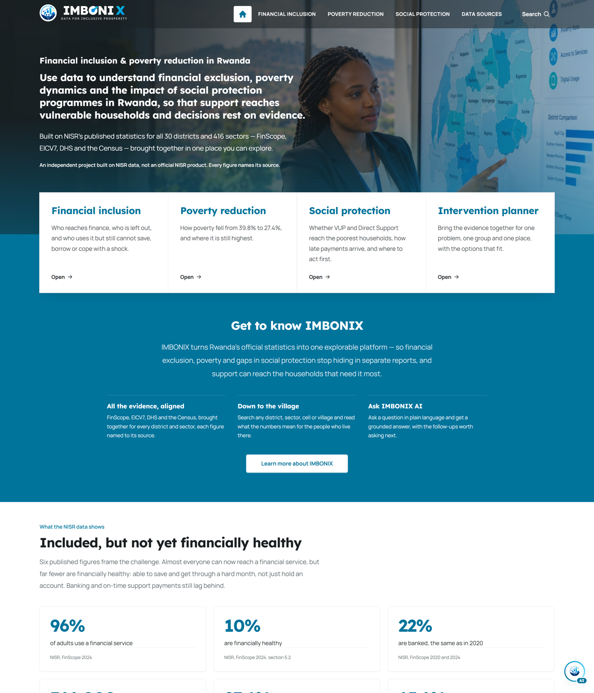

# IMBONIX — Submission Package

**NISR Big Data Hackathon 2026 · Track 2 — Financial Inclusion & Poverty Reduction**

_Data for Inclusive Prosperity_

---

Everything a judge needs, in reading order. Each document stands on its own; together they make the full case.

| #   | Read this                                        | For                                                                                                                                                                           | Time    |
| --- | ------------------------------------------------ | ----------------------------------------------------------------------------------------------------------------------------------------------------------------------------- | ------- |
| 1   | **[Solution overview](solution-overview.md)**    | The whole submission: problem → solution → data → tech → design → impact, with a **criterion-by-criterion mapping**. Start here.                                              | ~5 min  |
| 2   | **[Criteria evidence](criteria-evidence.md)**    | Each evaluation criterion answered **point by point**, with the evidence to demonstrate it — including the methodology summary, impact-measurement plan and adoption pathway. | ~5 min  |
| 3   | **[Demo script](demo-script.md)**                | A **90-second** pitch and a **3-minute** walkthrough, each mapped to the five criteria. Use it to drive the live app.                                                         | 1–3 min |
| 4   | **[IMBONIX AI](../ai-assistant.md)**             | How the grounded, multilingual, multimodal, voice-capable assistant is built, and why its answers can be trusted.                                                             | ~4 min  |
| 5   | **[AI-assistance disclosure](ai-disclosure.md)** | Required by the rules: how AI tools were used, and the team's responsibility for every figure.                                                                                | ~1 min  |

## The one-paragraph version

Rwanda has all but solved **access** to finance (96% included, FinScope 2024) but not **resilience** — only ~1 in 10
adults is financially healthy, and the households left behind cluster where poverty, poor nutrition and shocks overlap.
**IMBONIX** brings NISR's published figures together for all **30 districts** and **416 sectors**, labels every value
for trust, and turns them into clear starting points for action — paired with **IMBONIX AI**, a grounded assistant that
answers open questions about any place in plain language (EN / FR / Kinyarwanda), by voice or text, and reads uploaded
charts and reports. It is independent, open-source, and **not an official NISR product**.

## Five criteria, in one click each

| Criterion                             | Where to see it                                                                         |
| ------------------------------------- | --------------------------------------------------------------------------------------- |
| 1 · Problem understanding & relevance | Homepage gap chart + "Aligned to national priorities"; ask the assistant                |
| 2 · Data use & methodology            | `/about#sources` (the "Collected with" column), Method & Principles                     |
| 3 · Tech innovation                   | `/financial-exclusion/risk-model`, `/social-protection/policy-scenarios`, IMBONIX AI    |
| 4 · Usability & design                | Homepage, `/poverty-dynamics/district-map`, `/data/chart-library`                       |
| 5 · Tangible impact                   | `/social-protection/priority-districts`, the intervention planner, About → Who benefits |

## Run or view it

- **Locally:** `cd apps/web && npm install && npm run dev` → <http://localhost:3000>
- **Live:** _being (re)deployed — the public URL will be added here_ — everything deploys on [Vercel](../deployment.md#deploy-the-web-app-to-vercel) in one project (the JSON API ships with the site at `/api/v1`).
- **Turn on the AI (optional):** set a free `GEMINI_API_KEY` (or `ANTHROPIC_API_KEY`) in `apps/web/.env`; without a key
  the assistant uses its on-device engine, so the demo never depends on a secret.

## Team

IMBONIX was built by two students for the NISR Big Data Hackathon 2026:

| Member | Role |
| --- | --- |
| **Dieu Merci Niyonkuru** | Software development, UI/UX design, IMBONIX AI integration, and deployment. |
| **UMURERWA Divine** | Data analysis; data collection and sourcing of the NISR datasets (the figures the platform is built on); and development. |

Student IDs are ready for verification, and at least one team member is a Rwandan citizen.

## Submission checklist (per the NISR rules — due 30 October 2026)

- [x] **Public GitHub link** — this repository (public).
- [ ] **Deployed app link** — _(re)deploy to Vercel and record the public URL here_ (publicly accessible; no login, so no sample credentials needed).
- [x] **README** — the top-level [README](../../README.md) explains the data used, what the platform communicates, and how users interact with it.
- [x] **Script(s) / code** — the full source is in this repo and runs on any machine (`npm` or Docker; see [deployment.md](../deployment.md)).
- [ ] **Demo video** — a **screen recording** (`.webm` or `.gif`), **≤ 3 minutes**, showing the interface and features, added to the repo (e.g. a `demo/` folder). Use the [demo script](demo-script.md) to drive it. **← this is the one item still to produce.**
- [x] **Data file + link to the data** — the processed figures are committed in `apps/web/src/data/generated/`; the raw microdata is linked to the [NISR microdata catalog](https://microdata.statistics.gov.rw/index.php/catalog) (see the README **Declaration** and [docs/data/](../data/)).
- [x] **Declaration of own work + sources acknowledged** — README **[Declaration](../../README.md#declaration)**.
- [x] **AI disclosure** — [ai-disclosure.md](ai-disclosure.md).
- [x] **Team** — 2 students (Dieu Merci Niyonkuru and UMURERWA Divine, see **Team** above); at least one Rwandan citizen; **student IDs ready for verification**.
- [x] **Screenshots** — present in [docs/screenshots/](../screenshots/) and rendering in the README.

[Solution overview](solution-overview.md) · [Demo script](demo-script.md) · [IMBONIX AI](../ai-assistant.md) · [Main README](../../README.md)

